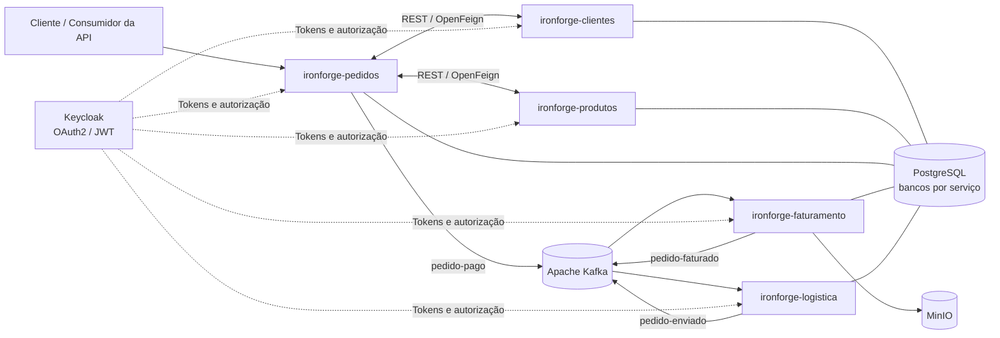

<div align="center">

# 🔥 IronForge API Ecosystem

### Ecossistema de microsserviços para um e-commerce de suplementos esportivos

Desenvolvido com **Java, Spring Boot, Spring Security, Keycloak, Apache Kafka e PostgreSQL**.


**Code. Learn. Build. Repeat.** 🚀

</div>

---

## 📚 Sumário

- [Sobre o projeto](#-sobre-o-projeto)
- [Objetivos e escopo](#-objetivos-e-escopo)
- [Funcionalidades](#-funcionalidades)
- [Arquitetura](#-arquitetura)
- [Microsserviços](#-microsserviços)
- [Fluxo completo do pedido](#-fluxo-completo-do-pedido)
- [Comunicação e eventos Kafka](#-comunicação-e-eventos-kafka)
- [Endpoints principais](#-endpoints-principais)
- [Segurança](#-segurança)
- [Tecnologias utilizadas](#-tecnologias-utilizadas)
- [Infraestrutura e portas](#-infraestrutura-e-portas)
- [Como executar](#-como-executar)
- [Testes automatizados](#-testes-automatizados)
- [Estrutura do repositório](#-estrutura-do-repositório)
- [Capturas de tela](#-capturas-de-tela)
- [Limitações conhecidas](#-limitações-conhecidas)
- [Autor](#-autor)

---

## 💡 Sobre o projeto

O **IronForge API Ecosystem** é um projeto de backend organizado em microsserviços que representam partes de uma plataforma de e-commerce de suplementos esportivos.

O sistema permite gerenciar clientes, endereços, produtos, estoque, pedidos, faturamento e entregas. Os serviços utilizam APIs REST para operações síncronas e Apache Kafka para propagar eventos entre etapas do processo de compra.

O projeto foi desenvolvido com foco em estudo e aplicação prática de conceitos como:

- Arquitetura de microsserviços e separação de responsabilidades.
- Integração síncrona com Spring Cloud OpenFeign.
- Comunicação assíncrona baseada em eventos com Apache Kafka.
- Autenticação e autorização com Keycloak, OAuth2 e JWT.
- Persistência com Spring Data JPA, Hibernate e PostgreSQL.
- Geração de documentos PDF com JasperReports.
- Armazenamento de arquivos com MinIO.
- Testes automatizados em todos os microsserviços.
- Ambiente de infraestrutura executado com Docker Compose.

> **Estado do projeto:** concluído. O sistema é um projeto de estudo; os fluxos de pagamento e transportadora são simulados e não representam integrações comerciais reais.

---

## 🎯 Objetivos e escopo

O objetivo é demonstrar como serviços independentes podem colaborar em um fluxo de negócio, mantendo responsabilidades separadas e utilizando mensageria para desacoplar o faturamento e a logística do processamento inicial do pedido.

O projeto **não utiliza API Gateway**. As chamadas HTTP entre os serviços são realizadas diretamente, por meio dos clientes configurados.

### O que o sistema faz

- Gerencia clientes e seus endereços.
- Mantém um catálogo de produtos com categorias e dados de estoque.
- Cria pedidos e consulta dados de clientes e produtos via OpenFeign.
- Gera uma chave de pagamento fictícia e aguarda um callback demonstrativo.
- Atualiza o status do pedido quando o callback informa o resultado do pagamento.
- Publica eventos Kafka após a confirmação de pagamento.
- Gera um documento PDF de faturamento e armazena o arquivo no MinIO.
- Cria um registro de entrega após receber o evento de pedido faturado.
- Aguarda um callback logístico para atualizar a entrega.
- Publica o evento de pedido enviado quando o status da entrega muda para `ENVIADO`.

### O que não faz

- Não processa pagamentos reais nem se conecta a um provedor financeiro.
- Não valida criptograficamente ou compara o valor do cabeçalho `apiKey` dos callbacks; o cabeçalho é demonstrativo.
- Não se comunica com uma transportadora real.
- Não utiliza API Gateway.
- Não possui pipeline de CI/CD configurado.

---

## ✨ Funcionalidades

| Área | Funcionalidades |
|---|---|
| Clientes | Cadastro, consulta, atualização, inativação e exclusão de clientes; operações de perfil do próprio usuário. |
| Endereços | Cadastro, consulta, atualização e exclusão de endereços vinculados a clientes. |
| Produtos | Cadastro, consulta, atualização, exclusão e listagem paginada de produtos ativos, com filtro por categoria. |
| Estoque | Gerenciamento dos registros de estoque; não ocorre baixa automática vinculada à criação do pedido. |
| Pedidos | Criação, consulta, atualização e solicitação de uma nova tentativa de pagamento. |
| Pagamento demonstrativo | Geração local de uma chave UUID e atualização do resultado por callback. |
| Faturamento | Consumo do evento `pedido-pago`, geração de documento PDF com JasperReports e armazenamento no MinIO. |
| Logística | Criação de entrega ao receber `pedido-faturado`, atualização por callback e publicação de `pedido-enviado`. |
| Segurança | Autenticação JWT e autorização por papéis com Keycloak. |
| Mensageria | Publicação e consumo de eventos Kafka em diferentes etapas do pedido. |
| Testes | Testes implementados nos cinco microsserviços. |

---

## 🏗️ Arquitetura

A arquitetura é composta por cinco microsserviços de negócio e um módulo de infraestrutura.



### Comunicação síncrona

O serviço `ironforge-pedidos` utiliza **Spring Cloud OpenFeign** para consultar:

- `ironforge-clientes`, para obter os dados do cliente.
- `ironforge-produtos`, para obter os dados dos produtos associados ao pedido.

Essas consultas ocorrem durante o processamento da requisição do pedido. O sistema também possui um componente local de pagamento demonstrativo, que gera uma chave UUID; ele não é um `@FeignClient` de pagamento.

### Comunicação assíncrona

O **Apache Kafka** conecta o fluxo de pagamento confirmado ao faturamento e, depois, à logística. Os consumidores recebem eventos publicados pelos serviços responsáveis por cada etapa.

### Bancos de dados

Os serviços utilizam PostgreSQL, com configurações de banco separadas por microsserviço. O H2 é utilizado nos testes descritos no projeto.

---

## 🧩 Microsserviços

### 1. `ironforge-clientes`

Gerencia os dados cadastrais dos clientes e seus endereços.

Principais responsabilidades:

- Cadastrar clientes por operações administrativas ou pelo próprio usuário autenticado.
- Consultar e atualizar o perfil do usuário autenticado.
- Consultar clientes por ID, ID do Keycloak, CPF ou e-mail, conforme as permissões.
- Inativar ou excluir clientes.
- Cadastrar, consultar, atualizar e excluir endereços.
- Relacionar o cliente ao identificador do usuário no Keycloak.

**Prefixos de rotas:** `/clientes` e `/enderecos`.

### 2. `ironforge-produtos`

Gerencia o catálogo de produtos.

Principais responsabilidades:

- Cadastrar, atualizar, consultar e excluir produtos.
- Listar produtos ativos com paginação.
- Filtrar produtos ativos por categoria.
- Manter dados relacionados ao estoque.

A criação, alteração ou exclusão de produtos exige o papel administrativo conforme as regras implementadas. As consultas de produtos estão disponíveis pelas rotas configuradas no controller.

**Prefixo de rota:** `/produtos`.

### 3. `ironforge-pedidos`

Orquestra a criação e o acompanhamento dos pedidos.

Principais responsabilidades:

- Receber pedidos e seus itens.
- Consultar cliente e produtos por OpenFeign.
- Calcular os subtotais dos itens e o valor total do pedido.
- Persistir o pedido e seus itens.
- Gerar uma chave de pagamento fictícia por meio de um componente local.
- Receber o callback demonstrativo do pagamento.
- Atualizar o status para `PAGO` ou `ERRO_PAGAMENTO`, de acordo com o resultado recebido.
- Publicar o evento `pedido-pago` somente após a confirmação de pagamento.
- Permitir uma nova tentativa de pagamento.
- Consumir eventos de faturamento e envio para atualizar informações do pedido, conforme os listeners e serviços configurados.

**Prefixos de rota:** `/pedidos` e `/pedidos/callback-pagamentos`.

### 4. `ironforge-faturamento`

Processa o faturamento dos pedidos pagos.

Principais responsabilidades:

- Consumir o evento `pedido-pago`.
- Evitar gerar outro documento quando já existe uma nota registrada para o mesmo pedido.
- Gerar um documento PDF com JasperReports.
- Armazenar o PDF no MinIO.
- Persistir os metadados do documento, incluindo número, chave de acesso, data de emissão e URL do arquivo.
- Publicar o evento `pedido-faturado`.

O PDF é um documento gerado pelo projeto para fins demonstrativos. A geração de um PDF não significa, por si só, emissão ou autorização de uma NF-e fiscal oficial.

### 5. `ironforge-logistica`

Gerencia os registros de entrega dos pedidos faturados.

Principais responsabilidades:

- Consumir o evento `pedido-faturado`.
- Criar e persistir uma entrega com status inicial `AGUARDANDO_TRANSPORTADORA`.
- Gerar uma chave logística fictícia por meio de um componente local.
- Receber callbacks demonstrativos com atualizações da entrega.
- Conferir se o identificador da entrega e a chave logística correspondem ao registro.
- Atualizar status, código de rastreio, transportadora e previsão de entrega quando esses dados forem informados.
- Registrar a data de envio quando a entrega muda para `ENVIADO`.
- Publicar `pedido-enviado` quando ocorre a transição para o status `ENVIADO`.

**Prefixo de callback:** `/logistica/callback-logistica`.

A integração com a transportadora é simulada. O componente que solicita a entrega gera uma chave local, sem chamada para uma API real de logística.

### 6. `ironforge-infra`

Reúne os arquivos de infraestrutura para executar os componentes auxiliares do ecossistema com Docker Compose, incluindo Kafka, Zookeeper, Kafka UI, PostgreSQL, MinIO e Keycloak.

---

## 🔄 Fluxo completo do pedido

O fluxo possui duas etapas de callback: uma para o pagamento e outra para a logística. Os eventos Kafka só são publicados nos pontos correspondentes do processo.

### Etapa 1 — Cadastro e criação do pedido

1. O cliente é cadastrado no serviço `ironforge-clientes`.
2. Os produtos são cadastrados no serviço `ironforge-produtos`.
3. O cliente autenticado envia `POST /pedidos` com os itens do pedido.
4. O serviço de pedidos consulta os dados do cliente e dos produtos por OpenFeign.
5. Os subtotais e o valor total são calculados, e o pedido é persistido.
6. O componente de pagamento demonstrativo gera uma chave UUID, que é associada ao pedido.

### Etapa 2 — Callback de pagamento

1. O sistema de pagamento fictício é representado por um callback enviado para `POST /pedidos/callback-pagamentos`.
2. O callback informa o identificador do pedido, a chave de pagamento, o resultado e, opcionalmente, observações.
3. O serviço procura o pedido pela combinação de ID e chave de pagamento.
4. Se o pagamento for aprovado, o pedido passa para `PAGO`, os dados necessários ao evento são carregados e o evento `pedido-pago` é publicado no Kafka.
5. Se o pagamento falhar, o pedido passa para `ERRO_PAGAMENTO` e o evento `pedido-pago` não é publicado.
6. O endpoint de callback está configurado como acessível sem autenticação JWT. O cabeçalho `apiKey` é demonstrativo e não tem seu valor validado.

### Etapa 3 — Faturamento

1. `ironforge-faturamento` consome o tópico `ironforge.pedidos.pedido-pago`.
2. O serviço gera um PDF com os dados do pedido, cliente e itens.
3. O arquivo é armazenado no bucket `ironforge-faturas` no MinIO.
4. Os metadados do documento são persistidos no banco do faturamento.
5. O serviço publica `pedido-faturado` no Kafka.

### Etapa 4 — Criação e atualização da entrega

1. `ironforge-logistica` consome o evento `pedido-faturado`.
2. Uma entrega é criada no banco com status `AGUARDANDO_TRANSPORTADORA`.
3. O serviço gera uma chave logística fictícia e a associa à entrega.
4. O callback demonstrativo da transportadora é enviado para `POST /logistica/callback-logistica`.
5. A aplicação procura a entrega pelo ID e pela chave logística recebidos.
6. O status e os demais dados fornecidos são atualizados.
7. Quando a entrega muda para `ENVIADO`, o serviço publica `pedido-enviado` no Kafka.
8. O serviço de pedidos consome o evento de envio para atualizar as informações correspondentes do pedido.

---

## 📨 Comunicação e eventos Kafka

Os nomes dos tópicos são configurados nas propriedades dos serviços.

| Tópico | Produtor | Consumidor | Finalidade |
|---|---|---|---|
| `ironforge.pedidos.pedido-pago` | `ironforge-pedidos` | `ironforge-faturamento` | Iniciar o faturamento após a confirmação de pagamento. |
| `ironforge.pedidos.pedido-faturado` | `ironforge-faturamento` | `ironforge-logistica` | Solicitar a criação do registro de entrega. |
| `ironforge.pedidos.pedido-enviado` | `ironforge-logistica` | `ironforge-pedidos` | Notificar o envio e atualizar as informações do pedido. |

Os eventos são serializados em JSON usando os serializers e deserializers Jackson para Kafka configurados no projeto. Os eventos incluem informações necessárias à próxima etapa, representadas por DTOs específicos.

### Por que usar eventos?

A mensageria reduz o acoplamento direto entre as etapas de faturamento e logística. O serviço produtor publica um evento, e o serviço consumidor o processa de forma independente da requisição HTTP inicial.

O comportamento em caso de falha, reprocessamento ou duplicidade também depende das configurações de consumidores e da lógica de cada serviço. O projeto inclui uma verificação para evitar gerar novamente um documento de faturamento quando já existe uma nota registrada para o pedido.

---

## 🌐 Endpoints principais

As rotas abaixo foram identificadas nos controllers do projeto. As permissões indicadas correspondem às anotações de autorização presentes nos endpoints; o comportamento completo também depende da configuração de segurança de cada microsserviço.

### Clientes — `/clientes`

| Método | Rota | Acesso | Descrição |
|---|---|---|---|
| `POST` | `/clientes/me` | `CLIENTE` | Cadastra o perfil do usuário autenticado. |
| `GET` | `/clientes/me` | `CLIENTE` | Consulta o próprio perfil. |
| `PUT` | `/clientes/me` | `CLIENTE` | Atualiza o próprio perfil. |
| `POST` | `/clientes` | `ADMIN` | Cadastra um cliente administrativamente. |
| `PUT` | `/clientes/{id}` | `ADMIN` | Atualiza um cliente. |
| `PATCH` | `/clientes/{id}/inativar` | `ADMIN` | Inativa um cliente. |
| `DELETE` | `/clientes/{id}` | `ADMIN` | Exclui fisicamente um cliente. |
| `GET` | `/clientes/{id}` | `ADMIN`, `SERVICO` | Consulta cliente por ID. |
| `GET` | `/clientes/keycloak/{keycloakId}` | `ADMIN`, `SERVICO` | Consulta pelo identificador do Keycloak. |
| `GET` | `/clientes/cpf/{cpf}` | `ADMIN`, `SERVICO` | Consulta por CPF. |
| `GET` | `/clientes/email/{email}` | `ADMIN`, `SERVICO` | Consulta por e-mail. |

### Endereços — `/enderecos`

| Método | Rota | Acesso | Descrição |
|---|---|---|---|
| `POST` | `/enderecos/me` | `CLIENTE` | Cadastra o endereço do próprio usuário. |
| `GET` | `/enderecos/me` | `CLIENTE` | Consulta o próprio endereço. |
| `PUT` | `/enderecos/me` | `CLIENTE` | Atualiza o próprio endereço. |
| `POST` | `/enderecos/cliente/{clienteId}` | `ADMIN` | Cadastra endereço para um cliente. |
| `PUT` | `/enderecos/{id}` | `ADMIN` | Atualiza um endereço. |
| `DELETE` | `/enderecos/{id}` | `ADMIN` | Exclui um endereço. |
| `GET` | `/enderecos/{id}` | `ADMIN`, `SERVICO` | Consulta endereço por ID. |
| `GET` | `/enderecos/cliente/{clienteId}` | `ADMIN`, `SERVICO` | Consulta endereço pelo cliente. |

### Produtos — `/produtos`

| Método | Rota | Acesso | Descrição |
|---|---|---|---|
| `POST` | `/produtos` | `ADMIN` | Cadastra um produto. |
| `PUT` | `/produtos/{id}` | `ADMIN` | Atualiza um produto. |
| `DELETE` | `/produtos/{id}` | `ADMIN` | Exclui um produto. |
| `GET` | `/produtos/{id}` | Conforme configuração global | Consulta produto por ID. |
| `GET` | `/produtos` | Conforme configuração global | Lista produtos ativos com paginação e filtro opcional por categoria. |

A listagem utiliza paginação; a configuração do controller define página inicial `0`, tamanho `10` e ordenação por nome crescente como valores padrão.

### Pedidos — `/pedidos`

| Método | Rota | Acesso | Descrição |
|---|---|---|---|
| `POST` | `/pedidos` | `CLIENTE` | Cria um pedido. |
| `PUT` | `/pedidos/{id}` | `CLIENTE`, `ADMIN` | Atualiza um pedido. |
| `GET` | `/pedidos/{id}` | `CLIENTE`, `ADMIN`, `SERVICO` | Consulta um pedido. |
| `GET` | `/pedidos/{id}/detalhes` | `CLIENTE`, `ADMIN`, `SERVICO` | Consulta o pedido com dados completos. |
| `POST` | `/pedidos/{id}/solicitar-novo-pagamento` | `CLIENTE`, `ADMIN` | Solicita uma nova tentativa de pagamento. |
| `POST` | `/pedidos/callback-pagamentos` | Sem autenticação JWT | Recebe o callback demonstrativo do pagamento. |

O callback de pagamento recebe um cabeçalho `apiKey`, mas o valor desse cabeçalho **não é validado**. A correspondência entre o ID do pedido e a chave de pagamento é verificada pela lógica do serviço.

### Callback logístico — `/logistica/callback-logistica`

| Método | Rota | Acesso | Descrição |
|---|---|---|---|
| `POST` | `/logistica/callback-logistica` | Conforme configuração de segurança do serviço | Atualiza uma entrega a partir do callback demonstrativo da transportadora. |

O controller exige o cabeçalho `apiKey`, mas seu valor não é validado. A lógica de negócio localiza a entrega usando o identificador e a chave logística enviados no corpo da requisição.

> Os exemplos de rotas não substituem a inspeção dos DTOs para conhecer todos os campos obrigatórios e formatos de payload. Consulte os DTOs de request correspondentes antes de enviar requisições.

---

## 🔐 Segurança

A segurança das APIs utiliza **Keycloak**, **Spring Security**, **OAuth2 Resource Server** e tokens JWT.

### Autenticação

Os serviços configurados como Resource Servers validam tokens JWT emitidos pelo Keycloak. O realm configurado é `ironforge-realm`.

### Autorização

Os papéis do realm são convertidos em autoridades Spring Security, permitindo proteger endpoints com anotações como `@PreAuthorize`.

| Papel | Utilização geral |
|---|---|
| `ADMIN` | Operações administrativas, como gerenciar clientes e produtos. |
| `CLIENTE` | Operações disponíveis ao usuário autenticado, como perfil e criação de pedidos. |
| `SERVICO` | Acesso de serviço a operações específicas utilizadas na comunicação interna. |

As permissões efetivas são definidas individualmente nos endpoints.

### Comunicação entre serviços

O serviço de pedidos possui configuração OAuth2 Client com o fluxo `client_credentials` para obter um token e enviá-lo nas requisições OpenFeign para clientes e produtos.

### Callbacks demonstrativos

Os endpoints de callback recebem o cabeçalho `apiKey` para simular a estrutura de uma integração externa. **Não há validação desse cabeçalho no projeto.** Nos fluxos de pagamento e logística, as chaves específicas do pedido ou da entrega são conferidas na lógica de negócio.

> Esta implementação é voltada a estudo. Os callbacks e a autenticação por cabeçalho descritos não devem ser considerados mecanismos prontos para proteger integrações de produção.

---

## 🧰 Tecnologias utilizadas

| Tecnologia | Uso no projeto |
|---|---|
| Java | Linguagem de programação. |
| Spring Boot | Aplicações e APIs dos microsserviços. |
| Spring Web | Endpoints HTTP/REST. |
| Spring Security | Autenticação e autorização. |
| OAuth2 Resource Server | Validação de tokens JWT. |
| OAuth2 Client | Credenciais de serviço nas chamadas OpenFeign. |
| Keycloak | Realm, tokens e papéis de acesso. |
| Spring Cloud OpenFeign | Comunicação síncrona entre pedidos, clientes e produtos. |
| Apache Kafka | Publicação e consumo de eventos. |
| Spring Data JPA | Persistência relacional. |
| Hibernate | Mapeamento objeto-relacional. |
| PostgreSQL | Banco de dados dos serviços. |
| H2 Database | Persistência em testes. |
| MapStruct | Mapeamento entre entidades e DTOs. |
| Jakarta Bean Validation | Validação de dados de entrada. |
| Lombok | Redução de código repetitivo. |
| JasperReports | Geração de PDF. |
| MinIO | Armazenamento de documentos. |
| JUnit 5 | Testes automatizados. |
| Mockito | Simulação de dependências nos testes. |
| MockMvc | Testes dos controllers HTTP. |
| Docker Compose | Inicialização da infraestrutura local. |

---

## 🐳 Infraestrutura e portas

As configurações do projeto indicam os seguintes endereços locais para os microsserviços:

| Serviço | Porta HTTP |
|---|---:|
| `ironforge-produtos` | `8081` |
| `ironforge-clientes` | `8082` |
| `ironforge-pedidos` | `8083` |
| `ironforge-faturamento` | `8084` |
| `ironforge-logistica` | `8085` |

Outros endereços utilizados pelas configurações locais:

| Componente | Endereço configurado |
|---|---|
| Keycloak | `http://localhost:8080` |
| Kafka | `localhost:29092` |
| MinIO API | `http://localhost:9000` |

Os microsserviços utilizam bancos PostgreSQL separados:

- `ironforge_clientes`
- `ironforge_produtos`
- `ironforge_pedidos`
- `ironforge_faturamento`
- `ironforge_logistica`

O MinIO está configurado para utilizar o bucket `ironforge-faturas`.

> Portas e endereços acima representam a configuração local encontrada nos arquivos fornecidos. Eles podem precisar de ajustes conforme o ambiente de execução e os arquivos do Docker Compose.

---

## 🚀 Como executar

### Pré-requisitos

- JDK compatível com a versão Java configurada nos módulos.
- Docker e Docker Compose.
- Maven ou Maven Wrapper, caso presente no repositório.
- Arquivos de configuração dos serviços e da infraestrutura.

### 1. Inicie a infraestrutura

No diretório `ironforge-infra`, execute:

```bash
docker compose up -d
```

Esse comando inicia os componentes declarados no arquivo Compose, como Kafka, Zookeeper, PostgreSQL, MinIO e Keycloak.

### 2. Confira as configurações

Antes de iniciar os microsserviços, confira os arquivos `application.yml` ou equivalentes para garantir que:

- O PostgreSQL está acessível e os bancos necessários existem.
- O Kafka está acessível no endereço configurado.
- O realm `ironforge-realm` e os clientes OAuth2 necessários estão configurados no Keycloak.
- O MinIO está acessível e as credenciais correspondem às configurações locais.
- As URLs OpenFeign apontam para os serviços corretos.

### 3. Inicie os microsserviços

Execute cada módulo individualmente, usando o Maven Wrapper se estiver disponível:

```bash
./mvnw spring-boot:run
```

No Windows, o comando normalmente é:

```powershell
.\mvnw.cmd spring-boot:run
```

Execute o comando dentro do diretório do microsserviço correspondente. Se o projeto não possuir Maven Wrapper, utilize Maven instalado:

```bash
mvn spring-boot:run
```

### 4. Execute os testes

Dentro de cada módulo:

```bash
mvn test
```

O projeto possui testes implementados nos cinco microsserviços. A execução completa também depende das configurações e dependências específicas de cada módulo.

### 5. Teste o fluxo de negócio

Para acompanhar o fluxo ponta a ponta:

1. Cadastre um cliente.
2. Cadastre um produto e os dados de estoque necessários.
3. Crie um pedido autenticado.
4. Recupere a chave de pagamento gerada e envie o callback de pagamento com os dados esperados pelo DTO.
5. Confira o evento `pedido-pago` e o processamento pelo faturamento.
6. Confira o PDF gerado no MinIO e o evento `pedido-faturado`.
7. Aguarde a criação da entrega e obtenha a chave logística associada.
8. Envie o callback logístico com a chave correta e status `ENVIADO`.
9. Confira a publicação de `pedido-enviado` e a atualização do pedido.

Os nomes e formatos exatos dos campos dos callbacks devem ser consultados em `RecebimentoCallbackPagamentoDTO` e `RecebimentoCallbackLogisticaDTO`.

---

## 🧪 Testes automatizados

Existem testes implementados em todos os microsserviços do ecossistema.

As categorias utilizadas no projeto incluem:

- **Repositórios:** testes de persistência com H2 e scripts SQL de preparação, conforme implementado nos módulos.
- **Serviços:** testes unitários utilizando Mockito.
- **Controllers:** testes de endpoints com MockMvc.
- **Mensageria:** testes relacionados a publicadores, consumidores e eventos Kafka.
- **Configurações:** testes dos componentes de configuração presentes nos módulos.

Os testes ajudam a validar regras de negócio, mapeamentos, respostas HTTP, segurança e integração entre componentes.

Não é informado um percentual de cobertura porque nenhum relatório de cobertura foi fornecido. A existência de testes nos microsserviços não implica, por si só, cobertura integral de todos os cenários.

---

## 📁 Estrutura do repositório

A organização lógica do monorepo é:

```text
IronForge/
├── ironforge-clientes/
├── ironforge-produtos/
├── ironforge-pedidos/
├── ironforge-faturamento/
├── ironforge-logistica/
├── ironforge-infra/
└── README.md
```

Cada microsserviço contém sua própria aplicação, controllers, DTOs, entidades, repositórios, serviços e configurações conforme as necessidades do módulo. Os nomes exatos de subdiretórios e arquivos podem variar de acordo com a estrutura atual de cada projeto.

---

## 🖼️ Capturas de tela


---

## ⚠️ Limitações conhecidas

O IronForge foi desenvolvido como projeto de estudo e possui comportamentos intencionalmente demonstrativos:

- **Pagamento fictício:** a chave é gerada localmente; não há integração real com banco, adquirente ou gateway de pagamento.
- **Callback de pagamento:** simula a notificação do resultado do pagamento e atualiza o status do pedido.
- **API key demonstrativa:** o cabeçalho `apiKey` é exigido nos callbacks, mas seu valor não é validado.
- **Logística fictícia:** a chave logística é gerada localmente; não há integração real com transportadora.
- **Estoque:** não existe baixa automática de estoque quando o pedido é criado.
- **Sem API Gateway:** os serviços são acessados diretamente.
- **Sem CI/CD:** não há pipeline automatizado de integração ou entrega contínua configurado.
- **Documento de faturamento:** o PDF é gerado pelo sistema para fins demonstrativos e não equivale, por si só, a uma NF-e oficial autorizada.
- **Ambiente local:** endereços, portas e credenciais de desenvolvimento devem ser revisados antes de qualquer implantação fora do ambiente local.

---

## 👨‍💻 Autor

**Henrique Oliveira Pires**

Estudante de Tecnologia em Sistemas para Internet no IF Goiano, com interesse em desenvolvimento backend Java, APIs REST, arquitetura de microsserviços, mensageria e segurança de aplicações.

---

<div align="center">

Se o projeto foi útil para seus estudos, considere deixar uma ⭐ no repositório.

**Code. Learn. Build. Repeat.** 🚀

</div>
